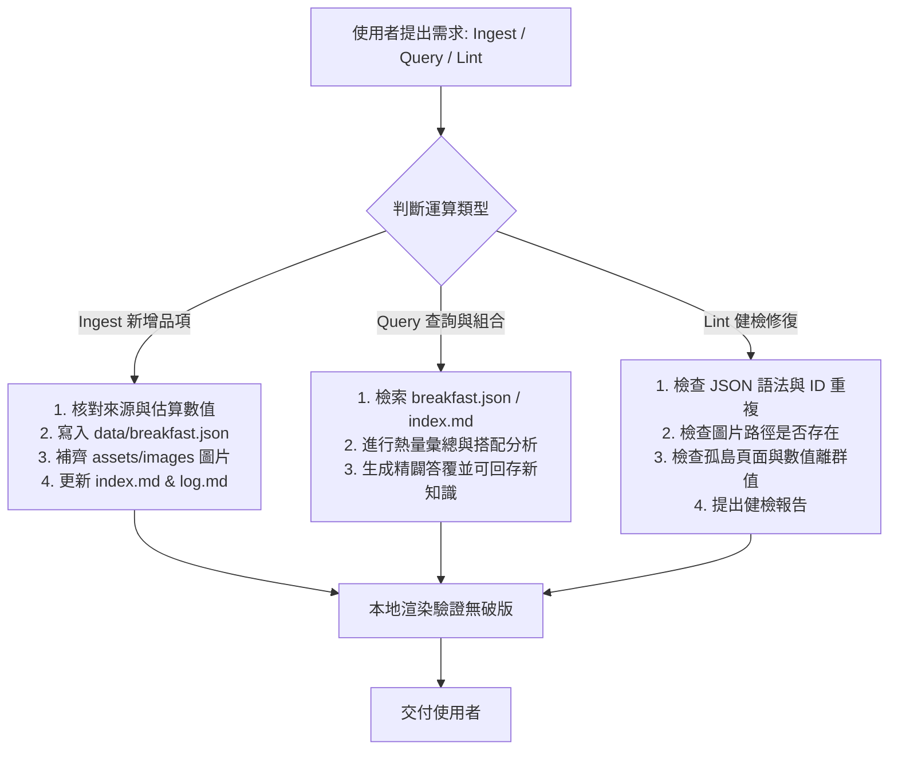

# 早餐店品項 Breakfast Wiki — AI 開發與維護規範 (AGENTS.md)

> 本規範依據 **Andrej Karpathy LLM Wiki** 核心架構制定，是所有參與本專案的 AI 代理人（AI Agents，如 OpenAI Codex、Claude Code、Gemini 等）必須嚴格遵守的作業手冊。
> 
> 在本專案中：
> - **人類（Human）** 是策劃者與探索者（Curator & Explorer），負責資料來源把關、提問與引導方向。
> - **AI（Agent）** 是知識庫的維護者與工程師（Maintainer & Programmer），負責摘要、跨頁交叉索引、資料結構化錄入與程式維護。
> - **Wiki** 是一份持久累積、具複利增長特性的實體資產（Persistent Compounding Artifact）。

---

## 一、專案目的 (Project Purpose)

1. **核心願景**：建立一套專注於「台灣在地早餐店餐點與營養資訊」的結構化知識庫網站。
2. **解決痛點**：外食早餐普遍存在油脂比例高、精緻糖或鈉含量隱蔽、優質蛋白質不足等資訊盲區。大眾點餐時難以迅速得知餐點的熱量與三大營養素配置。
3. **系統架構哲學**：
   - 拒絕純單次 RAG 的碎片化拼湊，改採 **LLM Wiki 知識預編譯與持久維護** 模式。
   - 不依賴複雜雲端後端、會員登入系統或外部付費 AI API，以純粹、輕量、透明的前端靜態架構（HTML5 / CSS3 / Vanilla JS / JSON）運作。
   - 透過嚴謹的 Schema（即本檔案 `AGENTS.md`）約束 AI 的新增與維護行為，確保任何人或 AI 皆能零門檻接手與擴充。

---

## 二、網站整體風格 (Design & Aesthetics Guidelines)

網站呈現**現代、清新、溫暖、具有早餐生活感**的視覺基調，禁止設計得如同冷冰冰的醫療掛號系統或沉重複雜的統計軟體。

1. **色彩系統規範**：
   - **主背景色**：米白色（`#FAF8F5`、`#FDFBF7`），提供柔和舒適的晨光晨食氛圍。
   - **品牌主調**：
     - 奶油黃（`#FFE382`、`#FFF8DB`）：象徵煎蛋與早晨陽光。
     - 淺藍色（`#7BA4D0`、`#EBF4FC`）：象徵晴朗天空與清爽感。
     - 咖啡色（`#4A3525`、`#70533C`）：象徵現磨咖啡與溫潤手感。
   - **卡片邊框**：溫潤淺米褐色（`#EEDBCC`、`#F2E7DC`），線條粗細為 `1.5px` 或 `2px`。
2. **卡片幾何與質感**：
   - 圓角卡片設計：大卡片圓角為 `16px ~ 20px`（`var(--radius-lg)`），標籤與按鈕採膠囊圓角（`9999px`）。
   - 輕柔陰影：`box-shadow: 0 4px 16px rgba(74, 53, 37, 0.06)`，懸浮（Hover）時微幅上浮 `translateY(-4px)` 並增強陰影。
3. **字型與用語**：
   - 必須使用**繁體中文（台灣習慣用語）**，例如：「吐司」、「漢堡」、「蛋餅」、「鐵板麵」、「蘿蔔糕」、「飯糰」、「大卡 (kcal)」。
   - 字型優先採用台灣常見系統無襯線字型：`-apple-system, BlinkMacSystemFont, "Segoe UI", "PingFang TC", "Noto Sans TC", "Microsoft JhengHei", sans-serif`。
4. **響應式支援**：
   - 全面支援電腦（Desktop）、平板（Tablet）與智慧型手機（Mobile）。
   - 斷點設定：`992px`（切換至單欄/滑動分類條）、`640px`（手機單欄適配）。

---

## 三、網站頁面結構 (Page Structure)

### 1. 首頁 (`index.html`) 包含以下四大必備區域：

| 區域編號 | 區塊名稱 | 核心內容與元件規範 |
| :--- | :--- | :--- |
| **區塊 1** | **網站標題與介紹區 (Hero)** | - 網站名稱：`早餐店品項 Breakfast Wiki`<br>- 副標題：`從日常早餐開始，認識每一份餐點的營養資訊。`<br>- 溫馨早餐意象插圖（`breakfast-hero.svg`）與收錄統計指標。 |
| **區塊 2** | **分類篩選與搜尋區 (Toolbar)** | - 分類按鈕群組：`全部`、`蛋餅類`、`吐司／三明治`、`漢堡／炸物`、`鐵板麵／中式`、`飲品與湯品`<br>- 即時關鍵字搜尋框（支援模糊即時比對餐點名稱與說明）。 |
| **區塊 3** | **早餐品項卡片區 (Cards Grid)** | - 動態從 `data/breakfast.json` 讀取並渲染。<br>- 卡片必須完整呈現：早餐名稱、分類、食物圖片、健康標籤、熱量 (kcal)、碳水 (g)、蛋白質 (g)、脂肪 (g)、簡短營養說明、「查看詳細資訊」按鈕。 |
| **區塊 4** | **網站頁尾 (Footer)** | - 專案名稱、導覽連結、AGENTS.md 入口。<br>- **強制標註免責聲明**：「本網站所有營養資訊僅供一般飲食規劃與大眾日常參考。熱量及各項營養素數據會因各早餐店之品牌、食材規格、分量比例及煎台烹調手法（如用油量、抹醬厚度）不同而有所差異。」 |

### 2. 詳細資訊彈出視窗 (Modal Overlay)：
- 點擊卡片或按鈕時彈出。
- 顯示大圖、完整介紹、三大營養素百分比條、飲食搭配小訣竅（`tips`）與資料來源（`source`）。
- 支援右上角關閉鍵、背景點擊與鍵盤 `ESC` 關閉。

### 3. 獨立頁面 (`pages/about.html`)：
- 說明專案由來、Karpathy LLM Wiki 精神、健康標籤客觀定義與飲食指南。

---

## 四、早餐資料新增格式 (Data Schema Specification)

所有餐點資料儲存於 `data/breakfast.json`。AI 新增資料時必須嚴格按照以下 JSON Schema，**嚴禁刪減或更名既有欄位**：

### 1. 欄位定義表

| 欄位名稱 (`Key`) | 型態 (`Type`) | 必填 | 說明與填寫指引 | 範例 |
| :--- | :--- | :---: | :--- | :--- |
| `id` | `String` | 是 | 唯一識別代碼，格式為 `item-XX`。 | `"item-01"` |
| `name` | `String` | 是 | 早餐中文品項名稱（台灣常見名稱）。 | `"原味蛋餅"` |
| `category` | `String` | 是 | 必須為既有 5 大分類之一（見後述分類清單）。 | `"蛋餅類"` |
| `healthLevel` | `String` | 是 | 健康分級代碼，僅能為 `"good"`、`"mid"`、`"alert"`。 | `"good"` |
| `healthLabel` | `String` | 是 | 對應之繁體中文顯示文字（見健康標籤規則）。 | `"均衡搭配推薦"` |
| `calories` | `Number` | 是 | 熱量估算值，單位 kcal（請四捨五入至整數）。 | `260` |
| `carbs` | `Number` | 是 | 碳水化合物含量，單位 g。 | `31.0` |
| `protein` | `Number` | 是 | 蛋白質含量，單位 g。 | `11.0` |
| `fat` | `Number` | 是 | 脂肪含量，單位 g。 | `10.5` |
| `description` | `String` | 是 | 50～90 字之簡短營養特點與口感介紹。 | `"經典傳統蛋餅，餅皮薄煎配上新鮮雞蛋..."` |
| `image` | `String` | 是 | 圖片相對路徑（指向 `assets/images/`）。 | `"assets/images/plain-egg-crepe.svg"` |
| `source` | `String` | 是 | 資料來源或估算依據（不可捏造檢驗數據）。 | `"衛生福利部食品營養成分資料庫估算"` |
| `tips` | `String` | 否 | 建議搭餐訣竅（例如：建議少抹醬、搭配無糖豆漿）。 | `"油脂主要來自煎台，建議少醬並搭無糖豆漿。"` |

### 2. 分類清單（不可任意發明新名稱）
1. `蛋餅類`
2. `吐司／三明治`
3. `漢堡／炸物`
4. `鐵板麵／中式`
5. `飲品與湯品`

### 3. 健康標籤規則（嚴格恪守客觀中立原則）
標籤僅用於客觀飲食調配參考，**嚴禁使用任何貶低飲食、批判體態外貌之字眼**：

- **`good`**（綠色）：**「均衡搭配推薦」**。蛋白質優質、醣脂比例適當或高纖。
- **`mid`**（黃色）：**「份量留意」**。碳水較高、含糖或單次份量較充裕，需留意全日總醣量。
- **`alert`**（橘紅色）：**「油脂或鈉含量留意」**。油炸、肥肉排、加工肉品或重鈉調味醬。

### 4. 標準範例 JSON 物件

```json
{
  "id": "item-19",
  "name": "起司豬排蛋吐司",
  "category": "吐司／三明治",
  "healthLevel": "mid",
  "healthLabel": "份量留意",
  "calories": 480,
  "carbs": 46.0,
  "protein": 26.5,
  "fat": 20.5,
  "description": "原塊里肌肉煎製配上濃郁融化起司片與荷包蛋，蛋白質極為豐富，能提供充沛的上午動能。",
  "image": "assets/images/cheese-pork-toast.svg",
  "source": "市售里肌肉吐司加起司片熱量估算",
  "tips": "起司已具備奶香鹹味，建議請店家不抹沙拉醬或減少醬油膏，避免攝入過多隱藏油脂與鈉。"
}
```

---

## 五、檔案命名與放置規則 (File Naming & Directory Structure)

專案結構如下，所有檔案必須各歸其所：

```text
breakfast-wiki/
│
├── AGENTS.md               # 本規範手冊（AI 開發指南）
├── index.html              # 網站首頁
├── index.md                # Karpathy LLM Wiki 內容索引清單
├── log.md                  # Karpathy LLM Wiki 時間軸異動日誌
│
├── data/
│   └── breakfast.json      # 核心結構化餐點資料庫
│
├── css/
│   └── style.css           # 全站共用樣式表
│
├── js/
│   └── main.js             # 篩選、搜尋、動態渲染與彈窗互動邏輯
│
├── pages/
│   └── about.html          # 關於本專案獨立頁面
│
└── assets/
    └── images/             # 圖片資源資料夾（SVG 插圖或餐點相片）
        ├── favicon.svg
        ├── breakfast-hero.svg
        └── *.svg / *.png / *.jpg
```

### 命名標準：
- **JSON 資料欄位**：駝峰式命名（CamelCase），如 `healthLevel`, `healthLabel`。
- **檔案與資料夾名稱**：全小寫、以連字號（kebab-case）分隔，例如：`pork-chop-sandwich.svg`。
- **圖片放置**：統一存放於 `assets/images/`，HTML/JSON 引用時使用相對路徑 `assets/images/<檔名>`。

---

## 六、AI 修改及新增內容時的規則 (AI Modification Rules)

未來任何 AI Agent 接獲使用者的指令時，必須遵守以下 7 條鐵律：

1. **先讀後動**：在動手編輯前，先完整閱讀本規範手冊 `AGENTS.md`。
2. **格式一體化**：嚴格參考 `data/breakfast.json` 現有資料格式，維持資料一致性，不得更換或刪除欄位。
3. **不得破壞舊資料**：新增品項時採 Append 模式加入陣列末尾，並檢查逗點與括號是否閉合，不得弄丟或改動其他原有項目。
4. **守住視覺調性**：嚴禁改動原本以米白、奶油黃、淺藍、咖啡色構成的生活感色系；嚴禁引入花俏外掛破壞簡約乾淨的圓角設計。
5. **備援資料同步**：若修改了 `data/breakfast.json`，請同步確認 `js/main.js` 頂端的 `BACKUP_BREAKFAST_DATA` 備援常數是否亦同步更新，確保雙擊 `file://` 時依然一致。
6. **落實雙重索引與日誌**：
   - 新增品項後，至 `index.md` 補上該品項的索引與單行摘要。
   - 至 `log.md` 依照統一前綴格式追加時間戳日誌（如 `## [2026-11-17] ingest | 品項名稱`）。
7. **獨立頁面擴充原則**：若新增獨立頁面（如 `pages/nutrition-guide.html`），必須繼承 `site-nav`、`site-footer` 與 `css/style.css`，並在導覽列加入對應入口。

---

## 七、資料管理規範 (Data Governance)

1. **真實客觀與估算聲明**：
   - 營養數據必須以「衛福部食品營養成分資料庫」或「連鎖門市公開平均值」為推估依據。
   - 數值一律標註為**參考估算值**，不得虛構為檢驗室精確檢測結果，亦不可捏造不存在的研究機構名稱。
2. **三大營養素熱量平衡檢核公式**：
   - 每 1 克碳水化合物 ≈ 4 kcal
   - 每 1 克蛋白質 ≈ 4 kcal
   - 每 1 克脂肪 ≈ 9 kcal
   - 檢核：`calories` 應約等於 `(carbs * 4) + (protein * 4) + (fat * 9)`（誤差容許 ±15%，因可能包含少許纖維、酒精或料理加權）。
3. **免責聲明一致性**：首頁與所有子頁面均必須保留營養估算免責條款。

---

## 八、AI 開發流程 (Agent Workflows)

借鑒 Karpathy LLM Wiki 的四大運算機制，AI 執行任務時採行標準化工作流：



### 1. Ingest 工作流（收錄新資料）：
- **步驟 1**：解析使用者提供的餐點名稱或食材配方。
- **步驟 2**：推算合理的熱量、三大營養素，並指派正確的 `category` 與 `healthLevel`。
- **步驟 3**：於 `data/breakfast.json` 末端新增物件，確保 JSON 語法無誤。
- **步驟 4**：建立或配置相應的 `assets/images/<name>.svg` 插圖。
- **步驟 5**：在 `index.md` 與 `log.md` 記錄該次收錄。

### 2. Query 工作流（查詢與飲食建議）：
- 當使用者詢問「減脂期去早餐店推薦點什麼？」或「這幾道熱量加起來多少？」時，AI 應先查詢 `data/breakfast.json`，計算加總數值，並輸出清晰的 Markdown 表格與搭配建議。

### 3. Lint 工作流（定期健康檢查）：
- 週期性或於大型修改後檢查：
  - 是否有未分配或錯誤分類的品項？
  - 是否有 `image` 路徑無效（404）的情形？
  - 是否有 ID 重複或熱量數值與三大營養素差距過大的異常項目？

---

## 九、網站品質檢查清單 (Quality Checklist)

在每次完成修改並向使用者交付前，AI 必須逐項確認：

- [ ] **格式規範**：`data/breakfast.json` 語法正確，無缺漏逗點或閉合括號。
- [ ] **分類對齊**：所有項目的 `category` 均在預設五大類範圍內。
- [ ] **視覺效果**：首頁卡片排列整齊，文字無溢出或換行截斷情形。
- [ ] **篩選功能**：切換「全部」、「蛋餅類」、「吐司／三明治」等按鈕，卡片正確過濾顯示。
- [ ] **詳細資訊彈窗**：點擊卡片能正確喚起 Modal，且三大營養素比例進度條顯示正確。
- [ ] **響應式排版**：窄螢幕（手機寬度 375px~430px）下按鈕可橫向捲動，卡片自然呈單欄堆疊。
- [ ] **免責聲明**：頁尾聲明清晰顯著。

---

## 十、未來擴充方向 (Roadmap & Evolution)

本專案保留充分的擴充彈性，未來可由 AI 依據需求接續開發：

1. **「今日早餐熱量小計算機」（Breakfast Calorie Builder）**：
   - 讓使用者勾選主餐與飲品，即時在右下角浮動條計算今日早餐的總熱量、蛋白質總量與醣類負擔。
2. **營養素排序與過濾器**：
   - 新增「依熱量由低到高」、「高蛋白質優先」、「低脂首選」等排序下拉選單。
3. **擴充在地早餐店特色專區**：
   - 增加「傳統中式永和豆漿系（油條、燒餅、鹹豆漿）」、「連鎖美芝城系」、「南部鍋燒意麵早點」等風格標籤。
4. **匯出與分享功能**：
   - 一鍵將個人的早餐搭配卡片轉為長圖或 PDF，方便記錄於個人飲食日誌中。

---
*本手冊旨在使所有協作 AI 皆能以一致、嚴謹且溫暖的步調，共同將 Breakfast Wiki 培育為歷久彌新的繁體中文早餐飲食百科。*
